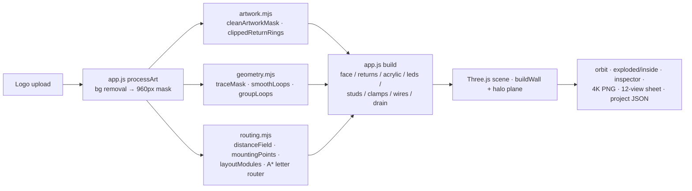

# Halo Studio — notes for Claude Code

Browser-only 3D visualizer for **halo-lit (reverse) channel letters**. Logo in → traced 3D sign with face, returns, acrylic back, LEDs, wires, studs, L-clamps, a wall and a halo → orbit view, exploded/inside views, 4K PNG export.
No backend, no API keys, no build step. Plain ES modules + vendored Three.js r186 + Clipper 6.4.2.

Origin: built in ChatGPT by a teammate and handed over on 2026-10-19 (`docs/handover/`). The first 10 commits are the original history; everything after that was made by us.

## Run

```sh
npm start                 # serves dist/ at http://127.0.0.1:8080 (needs a WebGL2 browser)
npm test                  # CPU geometry + mocked runtime tests (fast, no browser)
npm install && npx playwright install chromium   # once, for the visual test
npm run test:visual       # real Chromium on real GPU: times upload→built and saves screenshots to test-output/
```

`dist/` is the source, despite its name. Edit files there directly. Bump `?v=N` in `index.html`/`app.js` imports whenever you change a module, or browsers will cache the old one.

## Architecture



- World units: artwork width is normalised to 4 units. `inch = 4 / widthInches`. Face at z≈0, returns go to −z, then acrylic, gap, wall.
- `state()` reads the DOM. `update()` decides: geometry change → `build()`. Finish → `refreshSurfaces()`. LED/wall → `refreshWall()`. Lit/intensity → `refreshLighting()`.
- The halo is a blurred copy of the mask on an additive plane, not simulated light. Acrylic glow is emissive.
- A "letter" is a raster connected component, not a semantic glyph.

## Hard requirements (from the original requester; don't silently break them)

- Free only: no paid render or AI services.
- ≤ 5 s upload → usable frame (not yet measured on real hardware; `npm run test:visual` reports it).
- Defaults: 1″ depth, ¼″ wall gap, 6500K LEDs, 3/16″ acrylic back, 3–4 mounts per letter, ≥3 L-clamps per letter with 2 screws each. Power supply and junction box stay hidden behind the wall.
- Units are inches.
- Keep every live control working (orbit, views, finishes, LEDs, wall photo, modes, inspector, exports, save/load).

## Known issues / backlog (ordered)

1. ~~Auto background removal deleted white-on-transparent logos~~: fixed (auto now switches to alpha when the PNG has real transparency).
2. **Mirror finishes look dull.** Mirror gold reads as olive-brown paint because the synthetic env map (`init()` canvas → PMREM) has too little bright structure to reflect. Needs a better procedural or free HDRI environment, judged visually on a real GPU.
3. ~~`PCFSoftShadowMap` was removed in r186~~: now set to `PCFShadowMap` explicitly.
4. Halo is faint on light walls. Tune the blur/opacity in `buildWall()` against the gap.
5. The exploded view is cluttered at the default ¾ angle (layers overlap). Consider a side-biased camera for exploded mode.
6. `exitFocus()` resets the background to charcoal/plaster only, so a white wall is lost after using the inspector.
7. Stale comment "Exactly two mounting assemblies" in `build()`. The real rule is 3–4.
8. Wall photo is a flat texture, with no perspective. That is a product decision: the plan is to pass this tool's render to our Gemini mockup apps for scene compositing.
9. SVG is rasterised, so vector curves are lost. Native SVG path ingestion would fix that.
10. Performance: always-on render loop, 4096 shadow map, pixel ratio clamped to ≥1.75, all on the main thread. See `docs/handover/OPTIMIZATION.md`.

## Working rules

- Before calling a change done, run `npm test`, then `npm run test:visual`, then look at the screenshots in `test-output/`.
- Visual changes (materials, lighting, halo) must be judged on screenshots taken before and after with the same logo and camera.
- Add a fixture to `tests/fixtures/` for every artwork bug you fix.
