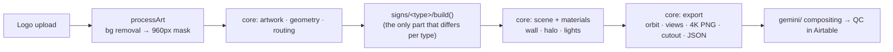

# Design Studio — notes for Claude Code

Browser-only 3D visualizer for **channel-letter signs**. Logo in → traced 3D sign → orbit, exploded/inside views, finishes, lighting, 4K PNG, transparent cutout for compositing.
No backend, no API keys, no build step. Plain ES modules + vendored Three.js r186 + Clipper 6.4.2.

Origin: Halo Studio, built in ChatGPT by a teammate and handed over on 2026-10-19 (`docs/handover/`). Everything after the original history was made by us.
Implemented: **halo-lit** and **face-lit**, both from the one `channel-letter` construction, chosen with the Sign type control. Code is organised by **construction** (how a sign is built), not by sign type: the studio's 65 variants come down to 5 constructions (channel-letter, media, cabinet, flat, tube). Variants are data. See "Adding a variant or construction".

## Run

```sh
npm start                 # serves app/ at http://127.0.0.1:8080: build board (landing), studio at /studio.html (needs WebGL2)
npm test                  # CPU geometry + mocked runtime tests (fast, no browser)
npm install && npx playwright install chromium   # once, for the visual test
npm run test:visual       # real Chromium: times upload→built, saves screenshots to test-output/ (+ cutout/ layers, alpha-checked)
HEADED=1 npm run test:visual   # watch it run
CHANNEL=msedge npm run test:visual   # use installed Edge if Playwright's Chromium won't install
cp -r test-output test-baseline      # once, before a change: keep the "before" screenshots
npm run test:compare      # after the change: pixel diff test-output/ vs test-baseline/ (same GPU)
```

Screenshots are deterministic on one machine (two runs are pixel-identical), so a refactor must give `All N screenshots match` (01–09 halo-lit, 10–15 face-lit).

Baseline (Intel HD Graphics 530, Edge; Playwright's Chromium install hangs on that PC): sample first build 5.0–8.1 s (over the 5 s budget, varies with machine load), uploads 1.2–3.2 s. Timings swing run to run, so compare a change against `main` timed back-to-back on the same machine, not against these numbers.

`app/` is the source (no build step). Bump `?v=N` in `studio.html` / module imports whenever you change a module, or browsers will cache the old one.

## Layout

```
app/
  index.html       landing page: build board from registry.mjs; "Open Design Studio" → studio.html, built variants → studio.html?type=<id>
  studio.html, style.css   the 3D studio ("← Build board" and the logo go back); studio.html?type=<registry id> opens that variant
  reference.html   construction reference library: every Estimator Side Views cross-section by construction, with PARTS specs and the registry rows sold with it; the studio's "Reference library ↗" opens it at reference.html#<sign id>
  references/      the cross-section PNGs (provided, unedited: replace a file, never redraw it) + library.mjs, the manifest (sign, mounting, thickness, source path)
  registry.mjs     every sign type x variant the studio sells, MOUNTING_SETS per construction, PARTS measured off the cross-sections (generated data: do not edit, report problems)
  app.js           UI + app state: controls, upload/processArt, modes, inspector, refresh*, capture, save/load
  core/            shared by EVERY sign type — change with care
    artwork.mjs    mask cleanup, return rings, region offsets (Clipper)
    geometry.mjs   trace, smooth, group loops
    routing.mjs    distance field, mounts, LED layout, wire A*
    materials.mjs  finishes, LED colour, env map, artwork colours
    scene.mjs      renderer, lights, camera framing, wall
    shapes.mjs     artwork space → world: pos, shapes, UVs, contours, flat caps
    glow.mjs       light planes: blurred image on an additive plane (halo, face glow)
    mounting.mjs   which mountings of each construction are built (sets come from MOUNTING_SETS in registry.mjs; only channel-letter flush draws geometry)
    hardware.mjs   part groups, LED modules + routed wiring, threaded studs, drain markers
    export.mjs     4K PNG, cutout layers (difference matte), download, contact sheet, project JSON
  signs/
    channel-letter/  build.mjs (CONFIGS switches, buildChannelLetter, light planes, `signs` interface) + CLAUDE.md
                     halo-lit and face-lit are configs of this one build
    <construction>/  one folder per construction, same shape (not created until its work starts)
tests/
  fixtures/        shared test logos (add one per artwork bug fixed)
  signs/<construction>/  per-construction tests (channel-letter/build-check.mjs)
gemini/            compositing prompts + AI Studio apps (NOT 3D code)
qc/                Airtable QC notes + report scripts
docs/handover/     original ChatGPT handover (read-only history)
```

**Sign interface.** Each `signs/<construction>/build.mjs` exports `signs`, one interface object per built config: `{id, label, standardDepth, depthRange {min,max} (both from the registry rows that open it), defaultIntensity (%), build(art,s,isLit,renderer) → {root, parts}, glow (light-plane builder or null; `userData.front` puts it in front of the sign instead of on the wall), wallDepth(s), wallGap(s), explodedOffsets (object or s => object), componentInfo, parts (explorer buttons), finishParts, internalHidden, assembledHidden, singleParts, hints, specs(s, ledLabel)}`. `app.js` registers them in `SIGNS` (ids = the Sign type control's values, also saved in projects) and never names a part or a sign type directly. Controls only one type uses carry `data-sign="<id>"` in `index.html`. Materials opt into live lighting via `userData`: `glowFactor` (emissive × intensity), `ledLens`, `litColour`/`unlitColour`.

## Architecture



- World units: artwork width is normalised to 4 units. `inch = 4 / widthInches`. The front of the sign is at z≈0 and everything else goes to −z. Halo-lit: face, returns, acrylic back, gap, wall. Face-lit: trim + acrylic face, returns, sealed back, wall (no gap).
- `studio.html?type=<registry id>` opens one studio variant: `app.js` finds the row in `registry.mjs` and the construction's `VARIANTS` entry (sign type + allowed select options, e.g. face-lit Premium = metallic trims). Unknown, unbuilt or missing ids keep the default and say so in a toast. The registry carries no construction config; that table lives with the construction.
- Rendering is on demand: `animate()` draws only when the camera moves or after `requestRender()`. Any input/change/click/keydown/wheel/pointerdown event and every scene function (`build`, `setMode`, `refresh*`, `view`, …) already request a frame; code that changes the scene some other way (a timer, an async load) must call `requestRender()` itself. The shadow map is redrawn only on `requestRender()` (the key light is fixed), never for a camera move.
- `state()` reads the DOM. `update()` decides: geometry change → `build()`. Finish → `refreshSurfaces()`. LED/wall → `refreshWall()`. Lit/intensity → `refreshLighting()`.
- The halo is a blurred copy of the mask on an additive plane, not simulated light. Acrylic glow is emissive. Face-lit faces are emissive too, from a baked texture (artwork colour × LED falloff), plus a face glow plane in front of them.
- Mirror finishes reflect `mirrorEnvironment()` (HDR softbox room, set as `envMap`); brushed, paint and the wall use `scene.environment` from `createEnvironment()`.
- A "letter" is a raster connected component, not a semantic glyph.

## Hard requirements (from the original requester; don't silently break them)

- Free only: no paid render or AI services. No paid tools.
- ≤ 5 s upload → usable frame (measure with `npm run test:visual` on a real GPU).
- Halo-lit defaults: 1″ depth, ¼″ wall gap, 6500K LEDs, 3/16″ acrylic back, 3–4 mounts per letter, ≥3 L-clamps per letter with 2 screws each. Face-lit defaults are in `signs/channel-letter/CLAUDE.md`. Power supply and junction box are not drawn: behind the wall for flush mounting, inside the raceway for raceway mounting (`psuInside` in `MOUNTING_SETS`).
- Units are inches. Currency USD.
- Keep every live control working (orbit, views, finishes, LEDs, wall photo, modes, inspector, exports, save/load).

## Rules for core/ vs signs/

- Anything two constructions would share goes in `core/`. Anything specific to one construction (trim cap, acrylic back, halo, face glow) goes in `signs/<construction>/`. Variants of one construction differ by config, never by a copied file.
- `core/` must never import from `signs/`. Signs import from core.
- A change in `core/` can break every sign type: run all tests, and compare screenshots for each implemented type.
- Do not copy code between sign folders. If a second type needs it, move it to `core/` first.

## Adding a variant or construction

- **A new variant of an existing construction** (e.g. side-lit channel letters): add its switch combination to that construction's `CONFIGS`, build the pieces it needs inside the same `build.mjs`, expose it in `signs`, add screenshots and test assertions. No new folder.
- **A new construction** (flat, cabinet, tube, media):
  0. Read its cross-sections in `reference.html` (`app/references/`) first: they are the shop's drawings, and `PARTS` is read from them.
  1. Create `app/signs/<construction>/` with `build.mjs` and a short `CLAUDE.md` (construction rules, switches, what is lit, defaults).
  2. Reuse `core/` for tracing, finishes, wall, mounting, export. Only write the construction.
  3. Add a fixture logo and a test in `tests/signs/<construction>/`.
  4. Get one construction fully working (screenshots reviewed) before starting the next.
  5. Do not create empty folders for constructions you have not started.

## Backlog (ordered)

1. **Prototype Gemini compositing + QC.** Send the cutout + scene photo to a Gemini app; score "sign unchanged?" in Airtable (human QA is the scoreboard). Compare against the old numbers: Flash 83% painted, 78% metallic.
2. **Performance + cleanup.** Done: render on demand, shadow map only on scene changes (idle 0 draws, orbit ~4.5 ms/frame on HD 530). Open, both change pixels so need sign-off: the preview pixel ratio floor of 1.75 on 1× screens, and the 4096 shadow map size. See `docs/handover/OPTIMIZATION.md`.
3. **Channel-letter mountings beyond flush** (raceway 2″, three flat backers, backboard cabinet), declared per construction in `MOUNTING_SETS`. Waiting on inches from the shop; see `signs/channel-letter/CLAUDE.md`.
4. **More sign types**, one at a time (see above). Candidates from the handover: front + halo combo, non-illuminated, flat-cut, edge-lit acrylic, faux neon, cabinet, blade.
5. Smaller: exploded view clutter at ¾ angle (worse with deep face-lit cans); `exitFocus()` loses a white wall; SVG is rasterised so vector curves are lost; bronze mirror leans peach in front view (base colour `#b98460`); cutout export has no wall-shadow layer and takes 4–7 s (three 4K renders).

Wall photo is a flat texture with no perspective. That is a product decision: perspective compositing into real scenes is done on the Gemini side.

## Working rules

- Build and test incrementally: one change at a time.
- Before calling a change done: `npm test`, then `npm run test:visual`, then look at the screenshots in `test-output/`.
- Visual changes (materials, lighting, halo) must be judged on screenshots taken before and after with the same logo and camera.
- Add a fixture to `tests/fixtures/` for every artwork bug you fix.
- Be transparent: say what was verified and what was not (e.g. "not run on a real GPU"). Do not claim a render looks right without looking at it.
- Keep code and notes in English.
