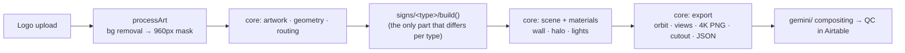

# Design Studio — notes for Claude Code

Browser-only 3D visualizer for **channel-letter signs**. Logo in → traced 3D sign → orbit, exploded/inside views, finishes, lighting, 4K PNG, transparent cutout for compositing.
No backend, no API keys, no build step. Plain ES modules + vendored Three.js r186 + Clipper 6.4.2.

Origin: Halo Studio, built in ChatGPT by a teammate and handed over on 2026-10-19 (`docs/handover/`). Everything after the original history was made by us.
Today only **halo-lit** is implemented. Other sign types are added one at a time (see "Adding a sign type").

## Run

```sh
npm start                 # serves app/ at http://127.0.0.1:8080 (needs a WebGL2 browser)
npm test                  # CPU geometry + mocked runtime tests (fast, no browser)
npm install && npx playwright install chromium   # once, for the visual test
npm run test:visual       # real Chromium: times upload→built, saves screenshots to test-output/ (+ cutout/ layers, alpha-checked)
HEADED=1 npm run test:visual   # watch it run
CHANNEL=msedge npm run test:visual   # use installed Edge if Playwright's Chromium won't install
cp -r test-output test-baseline      # once, before a change: keep the "before" screenshots
npm run test:compare      # after the change: pixel diff test-output/ vs test-baseline/ (same GPU)
```

Screenshots are deterministic on one machine (two runs are pixel-identical), so a refactor must give `All 9 screenshots match`.

Baseline (Intel HD Graphics 530, Edge; Playwright's Chromium install hangs on that PC): sample first build 5.0–8.1 s (over the 5 s budget, varies with machine load), uploads 1.2–3.2 s. Timings swing run to run, so compare a change against `main` timed back-to-back on the same machine, not against these numbers.

`app/` is the source (no build step). Bump `?v=N` in `index.html` / module imports whenever you change a module, or browsers will cache the old one.

## Layout

```
app/
  index.html, style.css
  app.js           UI + app state: controls, upload/processArt, modes, inspector, refresh*, capture, save/load
  core/            shared by EVERY sign type — change with care
    artwork.mjs    mask cleanup, return rings (Clipper)
    geometry.mjs   trace, smooth, group loops
    routing.mjs    distance field, mounts, LED layout, wire A*
    materials.mjs  finishes, LED colour, env map, artwork colours
    scene.mjs      renderer, lights, camera framing, wall
    export.mjs     4K PNG, cutout layers (difference matte), download, contact sheet, project JSON
  signs/
    halo-lit/      build.mjs (construction, halo, exploded offsets, inspector text) + its own CLAUDE.md
    <next-type>/   one folder per sign type, same shape
tests/
  fixtures/        shared test logos (add one per artwork bug fixed)
  signs/<type>/    per-type tests (none yet; halo-lit is covered by runtime-smoke + visual-smoke)
gemini/            compositing prompts + AI Studio apps (NOT 3D code)
qc/                Airtable QC notes + report scripts
docs/handover/     original ChatGPT handover (read-only history)
```

Still halo-specific inside `app.js` (move behind a sign interface when the second type starts): halo opacity factor (×1.15) in refreshLighting/intensity, `'Halo-lit'` status text, part names in setMode/inspectPart. `pos`/`shapes`/`uvGeometry` live in `signs/halo-lit/build.mjs` for now; move them to `core/` before a second type uses them.

## Architecture



- World units: artwork width is normalised to 4 units. `inch = 4 / widthInches`. Face at z≈0, returns go to −z, then acrylic, gap, wall.
- `state()` reads the DOM. `update()` decides: geometry change → `build()`. Finish → `refreshSurfaces()`. LED/wall → `refreshWall()`. Lit/intensity → `refreshLighting()`.
- The halo is a blurred copy of the mask on an additive plane, not simulated light. Acrylic glow is emissive.
- Mirror finishes reflect `mirrorEnvironment()` (HDR softbox room, set as `envMap`); brushed, paint and the wall use `scene.environment` from `createEnvironment()`.
- A "letter" is a raster connected component, not a semantic glyph.

## Hard requirements (from the original requester; don't silently break them)

- Free only: no paid render or AI services. No paid tools.
- ≤ 5 s upload → usable frame (measure with `npm run test:visual` on a real GPU).
- Defaults: 1″ depth, ¼″ wall gap, 6500K LEDs, 3/16″ acrylic back, 3–4 mounts per letter, ≥3 L-clamps per letter with 2 screws each. Power supply and junction box stay hidden behind the wall.
- Units are inches. Currency USD.
- Keep every live control working (orbit, views, finishes, LEDs, wall photo, modes, inspector, exports, save/load).

## Rules for core/ vs signs/

- Anything two sign types would share goes in `core/`. Anything specific to one construction (hardware, halo, face glow) goes in `signs/<type>/`.
- `core/` must never import from `signs/`. Signs import from core.
- A change in `core/` can break every sign type: run all tests, and compare screenshots for each implemented type.
- Do not copy code between sign folders. If a second type needs it, move it to `core/` first.

## Adding a sign type

1. Create `app/signs/<type>/` with `build.mjs` and a short `CLAUDE.md` (construction rules, what is lit, defaults).
2. Reuse `core/` for tracing, finishes, wall, export. Only write the construction.
3. Add a fixture logo and a test in `tests/signs/<type>/`.
4. Get one type fully working (screenshots reviewed) before starting the next.
5. Do not create empty folders for types you have not started.

## Backlog (ordered)

1. **Prototype Gemini compositing + QC.** Send the cutout + scene photo to a Gemini app; score "sign unchanged?" in Airtable (human QA is the scoreboard). Compare against the old numbers: Flash 83% painted, 78% metallic.
2. **Performance + cleanup.** Render on demand (not always-on), smaller shadow map, pixel ratio clamp. See `docs/handover/OPTIMIZATION.md`.
3. **More sign types**, one at a time (see above).
4. Smaller: exploded view clutter at ¾ angle; `exitFocus()` loses a white wall; stale "Exactly two mounting assemblies" comment in `build()` (real rule is 3–4); SVG is rasterised so vector curves are lost; bronze mirror leans peach in front view (base colour `#b98460`); cutout export has no wall-shadow layer and takes 4–7 s (three 4K renders).

Wall photo is a flat texture with no perspective. That is a product decision: perspective compositing into real scenes is done on the Gemini side.

## Working rules

- Build and test incrementally: one change at a time.
- Before calling a change done: `npm test`, then `npm run test:visual`, then look at the screenshots in `test-output/`.
- Visual changes (materials, lighting, halo) must be judged on screenshots taken before and after with the same logo and camera.
- Add a fixture to `tests/fixtures/` for every artwork bug you fix.
- Be transparent: say what was verified and what was not (e.g. "not run on a real GPU"). Do not claim a render looks right without looking at it.
- Keep code and notes in English.
