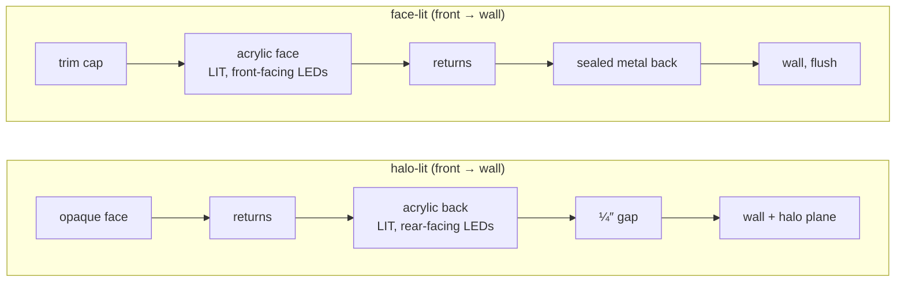

# Channel letters

`build.mjs` builds every channel-letter variant from the traced artwork: a can made of a face, returns and a back. The root `CLAUDE.md` rules apply. Shared code lives in `core/` and is never copied here.

A variant is a **construction config**, not code. `CONFIGS` holds the switches, `buildChannelLetter(art, s, isLit, renderer, config)` builds them, and `signs` exposes one interface object per built construction to `app.js`.

Marked **ASSUMED** = a guess, check it. Marked **ASK** = a real dimension we do not have; do not invent one.

## Construction switches

| Switch    | Values                                                   |
|-----------|----------------------------------------------------------|
| face      | `opaque` \| `acrylic` \| `none` \| `half-mirror`         |
| faceVinyl | `true` = opaque vinyl over the acrylic face              |
| returns   | `opaque` \| `translucent`                                |
| back      | `opaque` \| `acrylic` \| `mirror` \| `none`              |
| emit      | subset of `front`, `back`, `side`                        |

The switches say how light leaves the can. What each part is made of (and how thick) is `PARTS` in `registry.mjs`, measured off the Estimator cross-sections; an entry with `verified:false` is inherited, not measured.

- **Side-lit** is `{face: acrylic, faceVinyl: true, returns: translucent, back: opaque, emit: [side]}`: the same 3/16″ acrylic face as face-lit made opaque with vinyl, plus 3/16″ acrylic returns. Never model it as an opaque face part.
- **Fabricated non-lit** is `back: none`: open-back can, no LEDs, wiring or drain.

Built today:

| Construction | face | returns | back | emit | Light plane |
|---|---|---|---|---|---|
| halo-lit | opaque | opaque | acrylic | back | halo on the wall (`haloGlow`) |
| face-lit | acrylic | opaque | opaque | front | face glow in front of the face (`faceGlow`) |
| fabricated-nonlit | opaque | opaque | none | — | none (`lit: false`) |

Any other combination (side-lit, face & halo, face & side, infinity mirror's half-mirror face, open-face neon…) throws "construction not built yet" instead of rendering something half-right. Wiring one up means adding its pieces and its row to `CONFIGS`, plus screenshots.

Pieces are created in each construction's original order on purpose: Three.js sorts opaque meshes by material id before depth, so creating materials in a different order moves pixels on coplanar surfaces (trim band vs returns). Keep the order when editing.

## Shared by every channel-letter construction

- **Returns**: metal sidewalls at the full sign depth (behind the face). Wall = the smaller of the `PARTS` returns gauge (face-lit 0.0630″; halo-lit's drawing gives none, so .040″ **ASSUMED**) and 22% of the letter's widest mount clearance. Built by Clipper offsetting so thin strokes and sharp corners stay closed. Never translucent and never lit, until `returns: translucent` is built.
- **LED modules**: 3 lenses each, placed by `layoutModules` and scaled to fit narrow strokes (`core/hardware.mjs`). Facing follows `emit`.
- **Wiring**: red and white runs between modules, A* routed inside the letter, shown as 18 AWG (illustrative).
- **Mounts**: 3–4 per letter (Auto, or forced 3 or 4), threaded studs into the wall.
- **Tiny pieces** (under 8 px² or 0.2% of the largest piece in the 960 px mask) get face, returns and back, but no LEDs, wiring, mounts, clamps or drain.
- **Not modelled**: power supply and junction box. With flush mounting (the only one built) they sit behind the wall; with raceway they sit inside the raceway (`psuInside` in `MOUNTING_SETS`).
- **Unlit mode**: every emissive is 0 and the light plane is hidden.

## Halo-lit (reverse) — `back: acrylic, emit: [back]`

Light leaves through the back only. The face and returns never glow.

- **Face**: opaque metal, .045″ with a small bevel and flat caps. It takes the selected finish. "Match artwork" uses each letter's own colour; patterned faces keep the artwork texture.
- **LEDs**: rear-facing, just behind the face, pointing at the acrylic.
- **Acrylic back**: 3/16″, cut to the letter contour. Clear, frosted or opal; emissive in the LED colour at intensity × face/edge factor: clear .12/.65, frosted .75/.95, opal 1.15/1.2.
- **Mounts**: hollow spacer as long as the wall gap, threaded stud through its bore, rivnut. Hardware scales to the stroke.
- **L-clamps**: one per mount (≥3 per letter), 2 screws each: one through the return, one through the acrylic back. Hidden in the Assembled view.
- **Drain**: one marker at the lowest point of each letter that has LEDs (illustrative).
- **Halo**: the mask blurred twice and stacked — core σ 0.4″ + gap, wide σ 1″ + 2.5 × gap at 45% — tinted with the LED colour, on an additive plane just in front of the wall. Opacity = intensity × 1.15. Not simulated light.
- **Defaults**: 48″ wide (4–240″), 1″ depth (custom 0.75–10″, from the registry), ¼″ wall gap (0.25–6″), 6500K, 75% intensity, clear acrylic, Auto mounts.
- **Exploded**: face +.9, LEDs +.6, wires +.4, returns and drain +.2, clamps −.35, acrylic −.55, studs −.7 (world units).

## Face-lit — `face: acrylic, back: opaque, emit: [front]`

The inverse of halo-lit: the acrylic moves to the front and is lit, the metal moves to the back and is sealed. Nothing glows behind the letters.

Shop decisions (2026-10-21):

| Question | Answer |
|---|---|
| Trim | Plastic **and** metallic trim are both sold, with their own colour independent of returns. Default plastic matching the artwork (QC once logged "trims should be black"; still an option). Metallic = brushed silver / gold / bronze. Via `?type=`, Standard shows the plastic trims, Premium the metallic trims and trimless. |
| Depth, LED throw | 3″ standard (custom 2.5–10″), both from the registry rows. Modules ~4″ apart at every depth (**ASSUMED**: a shallower can may need tighter spacing to avoid hot spots). |
| Face | User picks: white acrylic + translucent vinyl (follows the artwork) or solid-tinted acrylic (one colour per letter). |
| Mounting | Flush to the wall, gap 0. The other five channel-letter mountings (`MOUNTING_SETS` in `registry.mjs`) are declared and refused by name until built: see `core/mounting.mjs`. |
| Mounts | 3–4 per letter (as halo-lit): threaded studs through the back, nut inside the can. No L-clamps (their second screw needs an acrylic back). |
| LED colour | Full control. The face shows artwork colour × LED colour. |
| Weep holes | Yes, one per letter (indoor / outdoor is not modelled yet). |
| Intensity | Opens at 40%. |
| Small dimensions | From `PARTS` (cross-section, measured): face 3/16″ acrylic, returns 0.0630″ aluminium, back 0.1019″ aluminium. **ASSUMED**: trim .06″ thick with a ⅛″ lip. |

Construction (front → wall):

- **Trim cap**: a 1″ band over the returns plus a ⅛″ lip over the face edge, .06″ thick (lip and thickness **ASSUMED**). Never lit. `trimless` removes it; the face edge then takes the return colour.
- **Acrylic face**: translucent, cut to the letter outline, 3/16″ (`PARTS`). Takes no finish: its colour comes from the artwork.
- **LEDs**: front-facing on the sealed back, ~4″ pitch; a letter too small for that pitch gets halo-lit's denser spacing (every lit letter needs light).
- **Sealed back**: solid aluminium, 0.1019″ (`PARTS`). With the returns it forms a sealed can: no light path to the wall.
- **Weep hole**: at the lowest point of each letter, just above the back.

What is lit:

- **Face**: `emissiveMap` baked per sign = face colour (vinyl texture, per-letter tint, or white for an all-black logo) × LED falloff (≈55% linear between modules, 100% over each). Emissive = LED colour × intensity × 2.4 (`FACE_GLOW`). When lit the face's diffuse drops to 25% so the glow carries the colour; at full diffuse it washed to pastel.
- **Face glow**: the face colours blurred (σ 0.35″ + 1.4″ wide) on an additive plane just **in front of** the face, strength 0.8 × intensity (1.0 turned blue cyan and red pink). Added at the shop's request ("the face is not lit"). It is the only light plane; nothing is added behind the letters.
- **Dark accents** stay dark and unlit; an all-black logo lights white (Gemini's Black Logic — confirm it is still wanted).
- **Returns, trim, back**: never lit. A glowing return is a bug.
- **LED lenses**: emissive .7, hidden behind the face.
- **Exploded**: trim 1.05, face .7, LEDs and wires forward by the can depth + .3/.25, returns 0, back −.35, studs −.7.

Forbidden looks (from Gemini QC; most became impossible in a deterministic build, these need tests):

- Face darker than the wall (Gemini: 0.78× wall luminance). Flat uniform face. Blown-out face (hue washed to white).
- Any glow behind the letters, or a colour cast on the wall, raceway or backer.
- Glowing returns or trim. Hardware from an unselected mounting appearing (a backer or raceway strip under flush).
- Complaints were about dim faces far more than colour (≈5:1): err bright.

## Fabricated non-lit — `back: none, emit: []`

From the Estimator cross-section (`references/channel-letter/fabricated-nonlit/flush.png`, `PARTS['fabricated-nonlit']`):

- **Face**: 0.1019″ aluminium, the shared metal face (`metalFace`, same bevel and flat caps as halo-lit's, which is .045″ because its drawing gives no gauge). Takes the selected finish.
- **Returns**: 0.0630″ aluminium, same finish as the face, from the face back to the wall. They sit **on** the wall: no gap, no back panel (open can).
- **Studs**: 3–4 ¼″Ø threaded studs per letter, welded to the back of the face (boss + thread), through the empty can into the wall.
- **Nothing else**: no LEDs, wiring, drain, clamps or light plane. `lit: false` hides Lit/Unlit and the LED/intensity controls (`data-sign="halo-lit face-lit"`), and shows the daylight (unlit) view; switching back to a lit sign turns lighting back on. The view sheet captures only the 6 unlit views.
- **Defaults**: 1″ depth (0.75–10″, registry), 48″ wide, flush.
- **Variants**: one finish each (Polished/Brushed Gold, Bronze, Silver → `*-mirror` / `*-brushed`); "Painted Finish (Same as logo)" offers artwork colours, black, white or custom paint (matte / satin / gloss sheen). The registry's ninth finish, **Bronze Antique**, is `bronze-antique` in the Finish list (every metal sign; no variant row of its own): dark chocolate bronze with a seamless mottled patina and a wax coat, **invented** at the user's request (no shop sample): tune it on screenshot 19 if a sample arrives.

## Variants (registry ids)

`app/registry.mjs` lists every studio variant; its rows have no construction config, so the mapping lives in `app.js` / this folder (see root `CLAUDE.md`). Built rows: Halo-Lit (Back-lit), Face Lit (Premium Channel Letters), Face-Lit (Standard Channel Letter), each indoor and outdoor. The 7 Dimensional Fabricated Letters rows too: their `status` was set to `done` by hand on 2026-10-22 at the user's request, so the source generator must mark them done as well or the next regeneration reverts it (build-check would then list them as waiting). `stand_in` in the registry is a pricing placeholder, never a construction hint.

## Tests

- `tests/signs/channel-letter/build-check.mjs` (in `npm test`): face-lit part list (no halo, acrylic back, clamps, raceway or backer), piece counts, ≥3 mounts and one weep hole per piece, LEDs present, only face and LED lenses glow, nothing lit behind the sealed back, face glow in front, unlit = no emissive, trimless removes only the trim; halo-lit config builds an acrylic back with clamps; fabricated: face/returns/studs only, nothing glows lit or unlit, 0.1019″ face, returns reach the wall, depth from the registry; unbuilt switch combinations are refused.
- `tests/runtime-smoke.mjs`: 27 pieces and ≥81 clamps for halo-lit; switching halo-lit → face-lit → halo-lit in the app.
- `tests/visual-smoke.mjs`: screenshots 01–09 halo-lit, 10–15 face-lit, 16–19 fabricated (polished gold, exploded, painted, antique bronze; Lit/Unlit and LED controls hidden). On plaster the white face measures 0.93 vs wall 0.76 luminance; the colour face 0.86 value vs 0.77, saturation > 0.45. Fixture `logo-dark-accent.png` shows dark accents staying unlit.

## Open

- Raceway (2″, 0.1019″ aluminium), the three flat backers (ACM 4mm, acrylic 8mm, aluminium 2.5mm) and Backboard Cabinet (2″): height, overhang and fixings in inches (**ASK**).
- LED spacing at shallow depths (2.5–3″): modules stay ~4″ apart. Return colours: the registry has 9, the UI 3.
- Polished metallic trim? Black Logic still wanted? Indoor / outdoor (weep holes) later.
