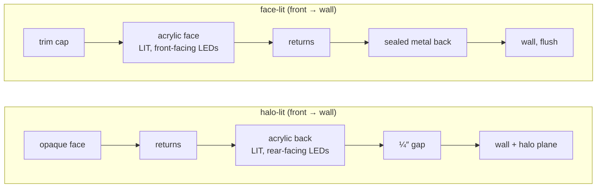

# Face-lit channel letters

`build.mjs` builds one sign from the traced artwork. The root `CLAUDE.md` rules apply. Shared code lives in `core/` and is never copied here.

Face-lit is the **inverse** of halo-lit: the acrylic moves to the front and is lit, the metal moves to the back and is sealed. Nothing glows behind the letters.

Marked **ASSUMED** = my guess, check it. Marked **ASK** = a real dimension I do not have; do not invent one.

## Decisions (2026-10-21, from the shop)

| Question | Answer |
|---|---|
| 1 Trim | Plastic **and** metallic trim are both sold. Trim has its own colour, independent of returns. Default: plastic trim matching the artwork (shop's choice, 2026-10-21; QC once logged "trims should be black", which is still an option). Metallic = brushed silver / gold / bronze. |
| 2 Depth, LED throw | 5″ standard (range 3–8″), LED modules ~4″ apart. |
| 3 Face | Both, user picks: white acrylic + translucent vinyl (multi-colour, follows the artwork) or solid-tinted acrylic (one colour per letter). |
| 4 Flush | Flat to the wall, gap 0. Raceway and backer come later, in `core/`. |
| 5 Mounts | Same count as halo-lit (3–4 per letter): threaded studs through the back, nut inside the can. No L-clamps. |
| 7 LED colour | Full control, as in halo-lit. The face shows artwork colour × LED colour. |
| 8 Weep holes | Yes, one per letter. |
| Small dimensions | Typical values, marked **ASSUMED** below: trim .06″ thick, ⅛″ lip, returns .040″, back .063″, face 3/16″. |

Still open: 6 (raceway and backer inches), and whether metallic trim should also come polished. The Black Logic rule (below) is implemented; confirm it is still wanted in 3D.

## Construction (front → wall)

- **Trim cap**: bezel wrapping the face perimeter and retaining it: a 1″ band over the returns plus a ⅛″ lip over the face edge (lip **ASSUMED**), .06″ thick (**ASSUMED**). Plastic (black / white / match artwork) or brushed metal (silver / gold / bronze). Never illuminated. `trimless` removes it and the face meets the returns directly; the face edge then takes the return colour.
- **Acrylic face**: translucent, cut to the letter contour, carries the artwork colour. 3/16″ **ASSUMED** (copied from halo-lit's back; a lit face is often thicker). Face type control: `film` = white acrylic + translucent vinyl, colour follows the artwork texture; `tinted` = solid-tinted acrylic, one dominant colour per letter.
- **Returns**: opaque painted metal sidewalls at the full sign depth, built by Clipper offsetting (same as halo-lit). Never translucent, never glow. .040″ wall **ASSUMED**, thinned on narrow strokes like halo-lit.
- **LED modules**: **front**-facing, towards the acrylic, on the sealed back. ~4″ pitch (shop answer). A letter too small for that pitch still gets modules at halo-lit's denser spacing: every lit letter needs light. Reuses `layoutModules` via `core/hardware.mjs`.
- **Wiring**: red and white runs between modules, A* routed inside the letter, 18 AWG (illustrative). Same as halo-lit.
- **Back**: solid opaque metal, fully closed. With the returns it forms a **sealed can** — no light path to the wall. This replaces halo-lit's acrylic back. .063″ **ASSUMED**.
- **Mounts**: flush threaded studs through the back into the wall, 3–4 per letter (same count as halo-lit, shop answer), nut inside the can. Halo-lit's L-clamps do **not** transfer: their second screw goes through an acrylic back that face-lit does not have.
- **Weep holes**: one at the lowest point of each letter (shop answer: yes). Drawn as halo-lit's drain marker, just above the back.
- **Tiny pieces**: same cutoff as halo-lit (under 8 px² or 0.2% of the largest piece in the 960 px mask) — face, returns, back, no LEDs or hardware. **ASSUMED**.
- **Not modelled**: power supply and junction box (behind the wall).

## What is lit

Light leaves **forward through the acrylic face only**. Zero light exits backward or sideways. There is no halo plane in this sign type.

- **Face glow** (added at the shop's request, 2026-10-21: "the face is not lit"): the face colours, blurred (σ 0.35″ core + 1.4″ wide), on an additive plane just **in front of** the face (`buildFaceGlow`, `core/glow.mjs`). It reads as the bloom a lit face shows in a photo and spills a little past the trim. Strength `GLOW` 0.8 × intensity; at 1.0 blue shifted to cyan and red to pink. Dark accents add nothing. Unlit: off.

- **Acrylic face**: emissive in the artwork colour, not the LED colour. The acrylic tints the light; the LEDs stay white. This is the opposite of halo-lit, where the LED colour *is* the visible colour.
- **LED lenses**: emissive, hidden behind the face. Value **ASSUMED** 0.7 (halo-lit's).
- **How it is built**: the face's `emissiveMap` is baked per sign: artwork colour (vinyl texture, or per-letter tint) × an LED falloff (≈55% linear between modules, 100% over each). Emissive colour = LED colour, intensity = intensity × 2.4 (`FACE_GLOW`, tuned on screenshots). When lit, the face's diffuse drops to 25% so the glow carries the colour; at full diffuse the colour washed out to pastel.
- **Returns, trim, back**: emissive 0, always. A glowing return is a bug.
- **Dark accents**: elements that are black or near-black in the artwork stay opaque and unlit. If the *whole* logo is black, the faces light white instead. (Carried from the Gemini prompt's Black Logic — confirm it still applies in 3D.)
- **Edge-lit backer** (backer mounting only): glow on the panel's own perimeter edge. This is the **only** legitimate light behind the letter plane, and the letters still do not back-glow.
- **Unlit mode**: every emissive is 0.

## Defaults (UI ranges)

| Setting | Default | Range |
|---|---|---|
| Width | 48″ **ASSUMED** | 4–240″ **ASSUMED** |
| Depth | 5″ | 3–8″ (the UI accepts 0.5–8″, shared with halo-lit) |
| Wall gap | 0″, flush | none (the gap control is hidden) |
| LEDs | 6500K white | every LED colour, as halo-lit |
| Intensity | 40% (shop's choice, 2026-10-21; halo-lit stays 75%) | 0–100% |
| Face acrylic | 3/16″ **ASSUMED**, vinyl | vinyl / tinted |
| Trim | match-artwork plastic | match-artwork / black / white plastic, silver / gold / bronze brushed metal, trimless |
| Return colour | match artwork | match artwork / white / black |
| Mounting | flush | flush only for now; raceway / backer later |
| Mounts | auto (3–4) | 3 / 4 / auto |

## Mounting hardware

Three variants. Only `flush` has ever been rendered in 3D; raceway and backer are new geometry.

- **Flush**: letters stud-mounted individually. Nothing else is drawn — no plate, rail, strip, tray or channel behind the letters. This was the single most expensive Gemini bug; in 3D it is just a control-state assertion.
- **Raceway**: slim horizontal duct, **shorter** than the letter run, letters centred on its front face, wall visible above and below. All dimensions **ASK**.
- **Backer**: panel behind the letters with padding, depth, sharp or rounded corners, metal or acrylic, optionally edge-lit. All dimensions **ASK** — the Gemini app exposed these as 0–100 sliders, never inches.

Raceway and backer belong in `core/`, not here: halo-lit will want both.

## Finishes

- The **face takes no finish**. It is translucent acrylic and its colour comes from the traced artwork. Halo-lit's "finish applies to the face" path must not run for this type.
- Finishes apply to **returns and trim cap only**.
- The Gemini prompt restricted returns and trim to black, white or match-artwork, and explicitly forbade metallic. The order catalogue contradicts this: *Standard Face Lit — Plastic Trim* and *Premium Face Lit — Metallic Trim* are separate products. Resolve before building (open question 1).

## Forbidden looks (from QC)

Most Gemini fails were the model disobeying prose. In a deterministic build they become impossible: missing elements, rearranged layout, malformed letters, tilt, wrong background, watermarks, wrong face colour. Do not carry those rules over as prompt text.

These survive and need test assertions:

- **Face darker than the wall.** Measured at 0.78× wall luminance in Gemini renders — that is why faces read as paint. Assert face luminance > wall luminance in the screenshot test.
- **Flat uniform face.** A constant emissive reads as paint even when bright. Some falloff between LED rows is wanted.
- **Blown-out face.** Too hot and the hue washes to white.
- **Any glow behind the letters.** No additive halo plane, no coloured light, no bloom post-process. The only light plane is the face glow, in front of the letters; tests assert it is in front (`userData.front`, z > 0).
- **Colour cast on wall, raceway or backer.** Only possible if a coloured light or bloom is added. Do not add one.
- **Glowing returns or trim.**
- **Hardware from an unselected mounting mode appearing** (a backer under flush, a raceway strip under flush).

Illumination complaints were about intensity far more than colour, dim roughly 5:1 over bright. Err bright.

## Differs from halo-lit

- Reused unchanged from `core/`: `artwork.mjs`, `geometry.mjs`, `routing.mjs`, `scene.mjs`, `export.mjs`.
- Done before this build (screenshots 01–09 pixel-identical): `pos`, `shapes`, `uvGeometry`, `flatCaps` → `core/shapes.mjs`; LED modules, wiring, studs, drain → `core/hardware.mjs`; the ×1.15 halo factor, `'Halo-lit'` strings and part names out of `app.js`, behind the `sign` interface (root `CLAUDE.md`).
- The forward-emissive face lives in `signs/face-lit/build.mjs` (`faceMaterial`), not `core/materials.mjs`: no other type uses it yet. Move it to core when one does.
- Root `CLAUDE.md` world-unit line now describes both stacks.
- `signs/face-lit/` owns: the inverted stack, trim cap and trimless, the sealed back, front-facing LED orientation, and the inspector text.

## Exploded view

Order front to back: trim, acrylic face, LEDs, wires, returns, back, studs. LEDs and wires move forward by the can depth so they clear the returns (`explodedOffsets(s)`). Still busy at the ¾ angle, like halo-lit (root backlog).

## Tests

- `tests/signs/face-lit/build-check.mjs` (in `npm test`): part list (no halo, acrylic back, clamps, raceway or backer), piece counts, ≥3 stud mounts and one weep hole per piece, LEDs present, only face and LED lenses glow, nothing lit behind the sealed back, unlit = no emissive, trimless removes only the trim.
- `tests/runtime-smoke.mjs`: switching halo-lit → face-lit → halo-lit in the app (no halo mesh, inside view hides face and trim).
- `tests/visual-smoke.mjs` screenshots 10–15 on plaster: white face luminance > wall (measured 0.93 vs 0.76), colour face value > wall and saturation > 0.45 (measured 0.86 / 0.70). Fixture `logo-dark-accent.png` (green letters + near-black bar) shows dark accents staying unlit.

## Open questions (original list; answers in Decisions above)

1. **Trim**: the catalogue sells plastic trim and metallic trim as separate products, the prompt forbade metallic. Which is right, and does trim colour need to be independent of return colour? QC logged "trims should be black" and a metallic-trim order rendered with black plastic.
2. **Depth and LED throw**: what depth do you actually build, and what row pitch gives an even face? Both drive whether the face looks lit or painted.
3. **Face acrylic**: white/opal diffuser with a coloured film on top, or solid-tinted acrylic? This changes how the emissive is built.
4. **Flush mounting**: flat to the wall, or on studs with a standoff? The Gemini app had a standoff slider; halo-lit's ¼″ gap is halo-specific.
5. **Mount count and hardware** per letter, now that there is no acrylic back to clamp to.
6. **Raceway and backer dimensions** in inches — the Gemini app only ever had 0–100 sliders.
7. **LED colour**: is it a user control here at all, given the acrylic does the colouring?
8. **Weep holes** on outdoor cans — model them or not?
